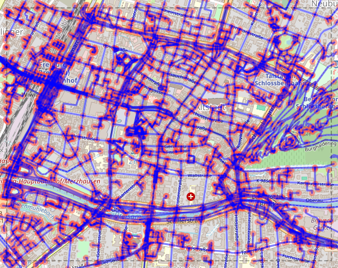
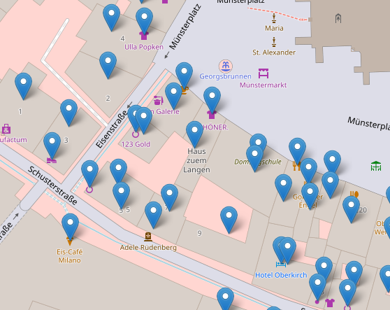

# pbf2sqlite

```
OpenStreetMap PBF/XML importer for SQLite

`pbf2sqlite` imports OpenStreetMap data from `.osm.pbf` or `.osm` files into an SQLite database.
It also provides commands for creating spatial indexes, address and routing tables, inspecting OSM elements,
executing SQL statements, visualizing geographic data, and calculating shortest paths.

Usage:
pbf2sqlite <database> [COMMAND ...]

+----------------------------------------------------+----------------------------------------------------+
|                      Command                       |                    Description                     |
+----------------------------------------------------+----------------------------------------------------+
| read <file>                                        | Import data from an `.osm.pbf` or `.osm` file.     |
| index                                              | Create basic database indexes.                     |
| rtree                                              | Create R*Tree spatial indexes.                     |
| addr                                               | Create address tables.                             |
| graph                                              | Create graph tables for routing.                   |
|                                                    |                                                    |
| node <id>                                          | Display information about a node.                  |
| way <id>                                           | Display information about a way.                   |
| relation <id>                                      | Display information about a relation.              |
| sql [<stmt>]                                       | Execute an SQL statement.                          |
|                                                    |                                                    |
| vaddr <lon> <lat> <length_m> <htmlfile>            | Create an HTML file that displays addresses.       |
| vgraph <lon> <lat> <length_m> <mode> <htmlfile>    | Create an HTML file that displays the graph.       |
|                                                    |                                                    |
| route <mode> <lon1> <lat1> <lon2> <lat2> [<lon3> <lat3> ...] <file>                                     |
|                                    Shortest-path routing: <mode> can be `foot` `bike` `roadbike` `car`. |
|                                                    |                                                    |
| map <lon> <lat> <zoom> <width> <height> <svgfile>  | Draw a map (not yet implemented...).               |
|                                                    |                                                    |
| mercator                                           | Add mercator projection in table `nodes`.          |
| version                                            | Print version numbers.                             |
+----------------------------------------------------+----------------------------------------------------+

Examples:

# Import an OpenStreetMap extract
pbf2sqlite map.db read germany.osm.pbf

# Create normal indexes, spatial indexes and routing tables
pbf2sqlite map.db index rtree graph

# Calculate a foot route
pbf2sqlite map.db route foot 13.3645 52.5108 13.4096 52.5182 my_route
```

The tables created are described in the [documentation](doc/pbf2sqlite.md).

OSM data can be obtained from a provider such as [Geofabrik](https://download.geofabrik.de).

The **vgraph** option creates a zoomable map of the graph:  



The **vaddr** option creates a zoomable map of the addresses:  



The [SQLite](https://www.sqlite.org) and the [readosm](https://www.gaia-gis.it/fossil/readosm/index)
libraries are used for this program.

See also notes on [compilation](doc/compiling.md).

|[**Download the latest version**](https://github.com/osmzoso/pbf2sqlite/releases/latest)|
|----------------------------------------------------------------------------------------|

